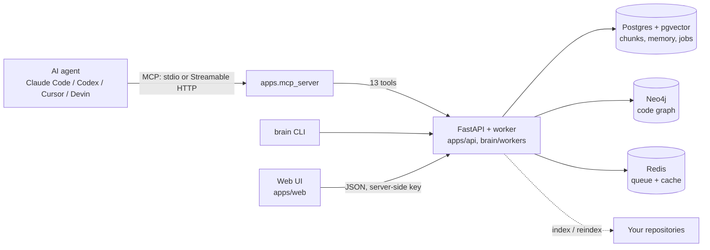
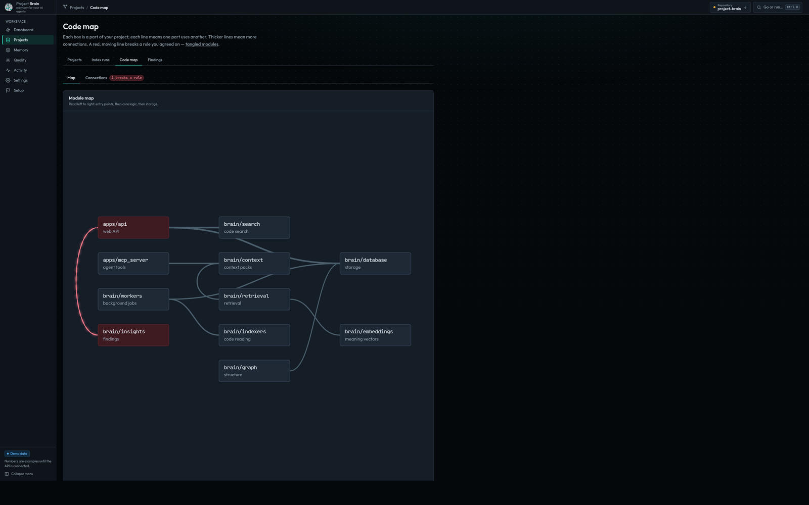

<p align="center">
  
</p>

<h1 align="center">Project Brain</h1>

<p align="center">
  <b>Long-term memory and a live code map for your AI coding agents.</b><br>
  Self-hosted and single-user: run it on your laptop or on your own server.
</p>

<p align="center">
  <a href="https://github.com/Perlitten/project-brain-public/actions/workflows/ci.yml"></a>
  <a href="LICENSE"></a>
  
  
</p>

<p align="center">
  <a href="#3-quickstart-local-single-user">Quickstart</a> ·
  <a href="#6-mcp-server">Connect your agent</a> ·
  <a href="#why-not-just-an-obsidian-vault">Why not Obsidian</a> ·
  <a href="#evidence-and-limitations">Limitations</a>
</p>

Coding agents have their own context and instruction mechanisms. Project Brain
adds a shared, inspectable code index and repository-scoped decisions, rules and
lessons across sessions and tools. Connect an agent through MCP to request task
context, then verify the returned evidence against current source.

Latest published release: **[v0.9.0](https://github.com/Perlitten/project-brain-public/releases/tag/v0.9.0)**.
The **main branch contains 0.9.1 development code**, not a published v0.9.1 release.
The source quickstart below installs main; release assets and their checksums are
on the v0.9.0 release page. Early, single-user software.

---

## About

| | |
|---|---|
| **What it is** | A memory and navigation layer for coding agents: code index (pgvector), dependency graph (Neo4j), scoped decisions and rules, a reviewed L1–L4 lesson memory, impact analysis and diff review. |
| **Who it is for** | One developer running AI agents across one or many repositories. One user, one instance. Not a team SaaS. |
| **Where it runs** | Locally (Docker + a Python venv, one bootstrap script) or on your own VPS (one compose file, TLS, OAuth for remote MCP clients). |
| **How agents use it** | 13 MCP tools over stdio or Streamable HTTP, plus resources, prompts, elicitation and sampling. Also a REST API, a CLI and a web dashboard. |
| **Your data** | Index and memory storage are self-hosted. Cloud model providers receive selected source text and prompts; use local models for local inference. See [data flows](docs/FAQ.md#where-does-my-data-go). |

## Why not just an Obsidian vault?

Obsidian is a great place for *you* to think. Project Brain is a place for your
*agents* to remember. Markdown notes are passive: nothing reads them unless you
paste them in, nothing notices when they go stale, and nothing ties them to the
code they describe.

| | Obsidian vault as agent memory | Project Brain |
|---|---|---|
| Who writes memory | You, by hand | Agents record decisions, rules and lessons through MCP; lessons need evidence and review before they become trusted |
| Who reads it | You, or an agent you paste notes into | Connected agents can request scoped context packs through MCP |
| Knows the code | No | Indexes files, symbols and the dependency graph; answers "what breaks if I change this?" |
| Stale knowledge | Stays until you delete it | Superseded decisions are replaced; historical docs are demoted in retrieval |
| Several projects | One vault, mixed notes | Rules and decisions are scoped per repository, so one project's rules never leak into another |
| Context size | Depends on what you include | Context packs select evidence; limits depend on the tool and rollout mode. Net token or cost savings are not established. |

Already have a vault? `brain import obsidian --vault /path/to/vault` turns it into
rules and decisions.

## What it is not

* Not a replacement for Claude Code, Codex or your IDE: they stay the hands that write code.
* Not a replacement for Git or CI.
* Not a note-taking app or a chat UI.
* Not a multi-tenant service: each person deploys their own instance.

---

## How it works



Brain tools answer from indexed chunks, the code graph and recorded memory.
Agents still need to inspect current source and run appropriate checks; retrieved
context is guidance, not a replacement for source verification.

## 3. Quickstart (local, single user)

Runs on one machine with your own repositories. **No API keys are needed** to
try it: the shipped `.env.example` uses mock LLM and embedding providers.
The mock is a **smoke test only — its results are not meaningful** (search
ranks by noise). For real results without a key, run
`ollama pull nomic-embed-text` and set `DEFAULT_EMBEDDING_PROVIDER=ollama`
before indexing; see [Real models](#real-models).

One command:

```bash
git clone https://github.com/Perlitten/project-brain-public.git project-brain
cd project-brain
./scripts/bootstrap.sh
```

This creates the venv, installs the package, writes `.env`, starts
postgres+redis+neo4j via Docker, and runs the `brain doctor` preflight.
Pass `--repo /path/to/your/repo` to choose the repository Brain reads; without
it Brain uses its own source as a sample. Then:

```bash
.venv/bin/brain index --repo /path/to/your/repo
./scripts/start.sh     # API :8000, worker, web dashboard :3100 — Ctrl+C stops all three
```

The worker runs indexing and every other background job. Without it, jobs stay
queued; the dashboard says so and shows how to start it.
From clone to first agent answer through MCP: **~2 min** on a clean Ubuntu
box (mock providers, measured 2026-10-12 — log in
[`docs/release/0.9.0/INSTALL.md`](docs/release/0.9.0/INSTALL.md)).

**Windows:** `scripts/bootstrap.sh` is POSIX-only. Run it inside WSL2, or use
the manual steps below. Native Windows is not tested in CI.

### What runs where

| Component | How it runs | Port |
|---|---|---|
| Postgres 15 + pgvector | Docker (`docker-compose.yml`) | 5433 |
| Redis 7 | Docker | 6379 |
| Neo4j 5 Community | Docker | 7474 / 7687 |
| API (FastAPI) | your venv, or the `api` container | 8000 |
| Worker (background jobs) | your venv, or the `worker` container | — |
| MCP server (stdio) | started by your AI client | — |
| MCP server (Streamable HTTP) | served by the API at `/mcp` | 8000 |
| Web UI (Next.js, optional) | `apps/web`, Node 22 | 3100 |

### Prerequisites

* Python 3.12 — the only version CI tests (`pyproject.toml` declares
  `>=3.10`, but 3.10 and 3.11 are untested)
* Docker with Docker Compose 2.24.0 or later (optional `.env` support)
* ~2 GB free RAM and ~2.5 GB free disk (service images ~1.2 GB + venv ~1 GB)
* Optional: Node.js 22 for the web UI (the version CI tests);
  `postgresql-client` (pg15) only for `scripts/backup_runner.py` backups

### Pre-built images: not a supported public installation yet

Anonymous GHCR access and a complete public image install have not been verified.
Use the source quickstart above. `docker-compose.quickstart.yml` is an experimental
configuration requiring an explicitly selected image tag and operator-supplied
credentials; it is not an advertised working public download-and-run path.

### Steps

```bash
# 1. Get the code and install the package (registers the `brain` command)
git clone https://github.com/Perlitten/project-brain-public.git project-brain
cd project-brain
python3 -m venv .venv
source .venv/bin/activate            # Windows PowerShell: .\.venv\Scripts\Activate.ps1
pip install -e ".[dev]"

# 2. Configure
cp .env.example .env                 # Windows: copy .env.example .env
# Set TARGET_REPO_PATH to the repository you want indexed (see below).

# 3. Start the storage services
docker compose up -d postgres redis neo4j

# 4. Preflight: python, .env, directories, provider keys, service health
brain doctor

# 5. Index a repository
brain index --repo /path/to/your/repo

# 6. Run the API and, in a second terminal, the worker (background jobs never
#    start without it). ./scripts/start.sh runs both plus the web dashboard.
uvicorn apps.api.main:app --port 8000
python -m brain.workers.worker
```

`TARGET_REPO_PATH` is the default repository for the server side (API, worker
jobs, web UI, `brain embeddings`, `brain doctor`). `REPO_ROOT` is only the
fallback for the CLI's `--repo` option (`brain index`, `audit`, `context`,
`eval`, `review-diff`; default `.`), so pass `--repo` explicitly as above.

Indexing a Git checkout uses tracked files and requires a clean committed tree.
Commit legitimate source changes before reindexing so the stored revision matches
the evidence. Ignored frontend outputs are not indexed; running or building the
dashboard must not require deleting generated files to reindex.

Check it:

```bash
curl http://127.0.0.1:8000/health
curl -H "X-API-Key: $(grep '^PROJECT_BRAIN_API_KEY=' .env | cut -d= -f2)" -H "Content-Type: application/json" \
     -d '{"repo_path": "/path/to/your/repo", "task_description": "add oauth login"}' \
     http://127.0.0.1:8000/context
```

API auth is on by default: every call needs `X-API-Key` equal to
`PROJECT_BRAIN_API_KEY` in `.env`. `scripts/bootstrap.sh` writes a random key
there. If you copied `.env.example` by hand, replace the placeholder first
(`python -c "import secrets; print(secrets.token_hex(32))"`): the API refuses to
start with `ENVIRONMENT=production` while the placeholder is still set.

**Everything in Docker instead.** `docker compose up -d --build` also builds and
starts the `api` and `worker` containers (the worker also runs the job scheduler). The containers see only the
Project Brain checkout (`/app`); to index another repository from inside them,
mount it into the `api` and `worker` services first.

Storage services can start before `.env` exists. Copy `.env.example` and configure
your providers, repository mounts and API key before using the API or worker.
API documentation (`/docs`, `/redoc`, `/openapi.json`) is disabled by default when
`ENVIRONMENT=production`. `API_DOCS_ENABLED=false` also disables it locally;
`API_DOCS_ENABLED=true` explicitly enables it, including in production.

### Evidence and limitations

Navigation quality and context budgets are measurable; they do not establish
coding cost savings. The agent benchmark separates file-location tasks from
coding tasks and records whether the agent actually called Brain. Its current
sample is small, and coding token savings are not established. L1–L4 memory
requires captured evidence and review; installing Brain does not supply a
pre-populated body of learned experience.

### Real models

Pick providers in `.env`, set the matching key, then re-index:

| Provider | `.env` |
|---|---|
| Mock (default, offline) — smoke test only, results not meaningful | `DEFAULT_LLM_PROVIDER=mock`, `DEFAULT_EMBEDDING_PROVIDER=mock` |
| Ollama (local, free, no key) | `ollama pull nomic-embed-text`, then `DEFAULT_EMBEDDING_PROVIDER=ollama` (add `ollama pull llama3.1` and `DEFAULT_LLM_PROVIDER=ollama` for summaries) |
| NVIDIA NIM (production default) | `DEFAULT_LLM_PROVIDER=nvidia`, `DEFAULT_EMBEDDING_PROVIDER=nvidia`, `NVIDIA_API_KEY=nvapi-…` |
| OpenAI / Anthropic / Google | `DEFAULT_LLM_PROVIDER=openai` (or `anthropic`, `google`) and the matching `*_API_KEY` |

Embeddings from different providers are not comparable. After switching the
embedding provider run `brain embeddings verify` and, if it reports
incompatible vectors, `brain embeddings backfill`.

#### Any OpenAI-compatible provider

LLM, summarizer and embedding calls go through one generic OpenAI-compatible
client (`brain/llm/providers/openai_compatible.py`), so any API that speaks
`/v1/chat/completions` and `/v1/embeddings` works: OpenAI, OpenRouter, Groq,
Together, DeepSeek, Mistral, Fireworks, NVIDIA NIM, Ollama, LM Studio, vLLM.
`mock`, `anthropic` and `google` keep their native adapters.

`DEFAULT_LLM_PROVIDER` / `DEFAULT_EMBEDDING_PROVIDER` take a preset name
(`openai`, `nvidia`, `openrouter`, `groq`, `together`, `deepseek`, `mistral`,
`ollama`, `lmstudio`) or `openai_compatible` (aliases `custom`,
`openai-compatible`). Presets only supply defaults (`brain/llm/presets.py`);
these universal settings override them for the selected provider:

| Variable | Meaning |
|---|---|
| `LLM_BASE_URL` | API root incl. version path, e.g. `https://openrouter.ai/api/v1` |
| `LLM_API_KEY` | Bearer key; falls back to the preset key (`GROQ_API_KEY`, ...). Optional for local endpoints |
| `LLM_MODEL` / `SUMMARIZER_MODEL` | main (synthesis) model / cheaper model for summaries & classification |
| `EMBEDDING_BASE_URL` / `EMBEDDING_API_KEY` | default to `LLM_*` when both roles use the same provider |
| `EMBEDDING_MODEL` / `EMBEDDING_DIMENSION` | dimension is required for non-preset models and must match the pgvector column |
| `EMBEDDING_MAX_INPUT_CHARS` / `EMBEDDING_BATCH_SIZE` | per-input char cap / inputs per request |

`LLM_TASK_*_MODEL` still override per-task routing. Examples:

```bash
# OpenRouter (chat); embeddings stay on another provider
DEFAULT_LLM_PROVIDER=openrouter
OPENROUTER_API_KEY=sk-or-...
LLM_MODEL=anthropic/claude-3.5-sonnet

# Groq
DEFAULT_LLM_PROVIDER=groq
GROQ_API_KEY=gsk_...
SUMMARIZER_MODEL=llama-3.1-8b-instant

# Ollama, fully local, no key (768-dim nomic-embed-text)
DEFAULT_LLM_PROVIDER=ollama
DEFAULT_EMBEDDING_PROVIDER=ollama
LLM_MODEL=llama3.1
```

Changing the embedding provider/model/dimension on an existing database
requires a full re-index; `brain doctor` fails early when the configured
dimension is unknown or contradicts the preset, and the embedding client
rejects vectors of the wrong width.

### Tests

```bash
pytest tests/ -q      # hermetic: ignores provider keys in your .env
ruff check .
```

---

## 4. Web UI

<p align="center"></p>

The API serves JSON only. The human interface is a separate Next.js app in
[`apps/web/`](apps/web/) that reads the API **server-side**, so the API key never
reaches the browser. Without an API configured it renders demo data.

```bash
cd apps/web
npm ci
cp .env.example .env.local     # BRAIN_API_URL=http://127.0.0.1:8000, BRAIN_API_KEY=<your key>
npm run dev                    # http://localhost:3100
```

| Variable | Purpose |
|---|---|
| `BRAIN_API_URL` | Base URL of the Brain API |
| `BRAIN_API_KEY` | Sent as `X-API-Key` from the server only |
| `WEB_BASIC_AUTH` | Optional fixed `user:password`; when set it wins and sign-in can't be changed from the dashboard |
| `BRAIN_WEB_ACTIONS` | `0` turns dashboard actions off; `1` turns them on without a password (behind your own SSO) |
| `BRAIN_TIMEZONE` | Optional IANA time zone for displayed times (default UTC) |

**Signing in.** A fresh install opens without a password while the dashboard
listens on this machine only (`npm run dev` / `npm run start` bind `127.0.0.1`;
change it with `WEB_HOST`) and says so in the top bar. On any other address it
stays locked until a sign-in exists. Set a login and password on **Settings → Access → Dashboard sign-in**: the
Brain API stores only a scrypt hash in its `.env` (`WEB_LOGIN_*`), the browser
that set it stays signed in and every other browser is signed out on each
change. Until a password exists, dashboard actions stay locked unless the
dashboard listens on loopback or runs under `npm run dev`. Forgot it? Delete the `WEB_LOGIN_*` lines from the server's
`.env` and restart the API. Scripts can sign in with `curl -u login:password`.

**Deploy to Vercel:** import the repository, set *Root Directory* to `apps/web`
(framework preset Next.js), add the variables above, deploy. Then set
`BRAIN_WEB_URL` in the API's `.env` to the UI address: `GET /` advertises it and
old `/dashboard` links redirect there. Any Node host works the same way with
`npm run build && npm run start`.

---

## CLI, memory and eval

- [`docs/CLI.md`](docs/CLI.md) — `brain` commands: index, health, audit, doctor, backup.
- [`docs/MEMORY.md`](docs/MEMORY.md) — L1–L4 memory semantics, consolidation gates, lesson protocol.
- [`docs/EVAL.md`](docs/EVAL.md) — golden tasks, benchmarks, adversarial verification, external imports.

## 5. Production Deployment

Use [`DEPLOYMENT.md`](DEPLOYMENT.md) for the full git-safe self-host guide. It
covers a fresh Ubuntu VPS, Docker Compose, nginx/TLS, the worker scheduler, repository mounts,
indexing, smoke tests, MCP client setup, backups, and safety rules. Day-2
operations (release layout, upgrades, rollback) are in
[`deploy/RUNBOOK.md`](deploy/RUNBOOK.md) and
[`docs/release/0.9.0/UPGRADING_AND_ROLLBACK.md`](docs/release/0.9.0/UPGRADING_AND_ROLLBACK.md).
The web UI deploys separately (section 4).

If an AI coding agent will do the deployment, start with
[`AGENT_DEPLOYMENT.md`](AGENT_DEPLOYMENT.md). It is stricter than the human
guide and includes command gates, failure playbooks, and a final report template.

The production compose file is [`docker-compose.prod.yml`](docker-compose.prod.yml).
It keeps Postgres, Redis, and Neo4j private to Docker, exposes the API on
loopback only, and expects nginx to terminate public HTTPS.

Minimal server flow:

```bash
sudo mkdir -p /opt/project-brain
sudo chown -R "$USER:$USER" /opt/project-brain
git clone https://github.com/Perlitten/project-brain-public.git /opt/project-brain
cd /opt/project-brain

cp deploy/.env.prod.example .env
chmod 600 .env
# Fill BRAIN_PUBLIC_HOST, NVIDIA_API_KEY (or your provider key),
# BRAIN_TARGET_REPO_DIR, and BRAIN_INDEXED_PROJECTS_DIR.

bash deploy/server_up.sh
```

Do not commit `.env`, `.secrets/`, `reports/`, or `context_packs/`. `.mcp.json` is
tracked but must stay secret-free: it carries `${VAR}` references, never a literal
`BRAIN_API_KEY`. `BRAIN_API_KEY` accepts either the shared `PROJECT_BRAIN_API_KEY`
or a scoped `pbk_` credential — prefer the scoped one: the remote MCP tools need
`core:write,jobs:read`, and a per-agent key is revocable without rotating the
shared secret (`scripts/mint_api_credential.py --name <agent> --scopes core:write,jobs:read`).

---

## 6. MCP Server

Project Brain ships two Model Context Protocol (MCP) servers: the local stdio
server `apps.mcp_server.server` exposes **13 tools**, and the remote HTTP-backed
server `apps.mcp_server.remote_server` exposes the same 13 plus
`get_diff_review` (**14 tools**):

| Tool | Purpose |
|------|---------|
| `ask_project` | LLM Q&A with retrieved code context |
| `prepare_task_context` | Build a context pack for a task |
| `prepare_deep_context` | Queue a quality-first LFM context pack in the background |
| `get_background_job` | Poll an asynchronous Brain job and retrieve its result |
| `impact_analysis` | Analyze change impact and risks |
| `record_decision` | Create or update a canonical global or repo-scoped architectural decision |
| `record_rule` | Create or update a global or repo-scoped normative rule |
| `search_code` | Hybrid file/symbol/chunk search |
| `find_related_files` | Neo4j graph neighborhood lookup |
| `review_diff` | Review git diff for rule violations (remote server: queues a job, poll with `get_diff_review`) |
| `get_diff_review` | Remote server only: poll a diff review queued by `review_diff` |
| `record_task_observation` | Record an unvalidated observation for a task (weak evidence for memory consolidation) |
| `record_task_lesson` | Record evidence-linked, reported validation; eligible L3 lessons can auto-promote, while high-risk cases and distilled L4 procedures require approval by default |
| `record_procedure_outcome` | Record the success/failure outcome of a procedure (skill) once per task |

`search_code` and `ask_project` accept an optional `repo_path` argument. Use it when
multiple repositories are indexed, for example `/indexed/mobile-app`, so retrieval
does not mix files from unrelated projects. The HTTP `/search` and `/ask` endpoints
accept the same `repo_path` field. For the remote MCP server, `BRAIN_REPO` is used
as the default repo scope when `repo_path` is omitted.

`record_decision` also accepts optional `repo_path`. Omit it only for a genuinely
global control-plane decision. Repository task state and architecture should use
the same canonical path passed to `prepare_task_context`.

`record_rule` follows the same scope rule. Context packs, Q&A, and diff review
load only global rules plus rules matching the selected canonical repository.

### Connecting an AI client

**Local (stdio).** The client starts the server itself; it reads the install's
`.env` and talks to Postgres, Redis and Neo4j directly, so the storage services
from the quickstart must be running.

```bash
# Claude Code (Windows: .venv\Scripts\python.exe)
claude mcp add project-brain -- /path/to/project-brain/.venv/bin/python -m apps.mcp_server.server
```

Other clients (Claude Desktop, Cursor) take the same command in their JSON config:

```json
{
  "mcpServers": {
    "project-brain": {
      "command": "/path/to/project-brain/.venv/bin/python",
      "args": ["-m", "apps.mcp_server.server"],
      "cwd": "/path/to/project-brain"
    }
  }
}
```

**Remote (HTTP).** To use a deployed Brain from another machine, run
`apps.mcp_server.remote_server` with `BRAIN_API_URL`, `BRAIN_API_KEY` and
`BRAIN_REPO` set; no local datastores are needed. The tracked `.mcp.json` does
exactly this from environment variables, and `.mcp.json.example` is the
template for clients that keep their config elsewhere. Details:
[`DEPLOYMENT.md`](DEPLOYMENT.md), section 10.

**Remote (native Streamable HTTP).** The API serves the same remote tool set at
`https://<host>/mcp`, so a client that speaks Streamable HTTP needs only the URL:

```bash
claude mcp add --transport http project-brain https://brain.example.com/mcp \
  --header "Authorization: Bearer pbk_..."
```

It accepts `Authorization: Bearer` or `X-API-Key` with any `pbk_` credential or the
legacy key. Tool calls run in-process with the caller's own credential, so scopes,
audit rows and telemetry attribute the agent exactly as the REST API would.
Sessions are stateful (elicitation and sampling need them), which is why the API
runs a single worker. `BRAIN_MCP_HTTP_ENABLED=false` turns the endpoint off.

**OAuth.** With `BRAIN_PUBLIC_URL` (or `BRAIN_PUBLIC_HOST`, read as `https://<host>`)
set, `/mcp` also advertises an OAuth 2.1 authorization server, for clients such as
claude.ai connectors that cannot be given a key: dynamic client registration,
PKCE, a consent page at `/oauth/consent`, one-hour access tokens and 30-day
rotating refresh tokens. The access token is an ordinary scoped `pbk_` credential
for a principal named `oauth:<client>:<id>`. Whoever clicks **Allow** signs in to the
web dashboard or enters an API key that already holds the requested scopes, so a
client never gets more than its approver could do directly.

Protocol details (annotations, resources, prompts, elicitation, deferred
payloads) and agent-side rules: [`docs/MCP.md`](docs/MCP.md).

## Contributing, security and changes

* [CONTRIBUTING.md](CONTRIBUTING.md) — development setup, checks and pull requests
* [SECURITY.md](SECURITY.md) — supported versions and how to report a vulnerability privately
* [CHANGELOG.md](CHANGELOG.md) — release history and unreleased changes
* [CODE_OF_CONDUCT.md](CODE_OF_CONDUCT.md)

---

## License

[MIT](LICENSE) © 2026 Andrei Damashkevich.

Project Brain builds on third-party libraries, fonts, container images and
models that keep their own licenses — see
[THIRD_PARTY_NOTICES.md](THIRD_PARTY_NOTICES.md). Product names mentioned in
this repository are trademarks of their owners; this is an independent
project, not affiliated with any of them.
