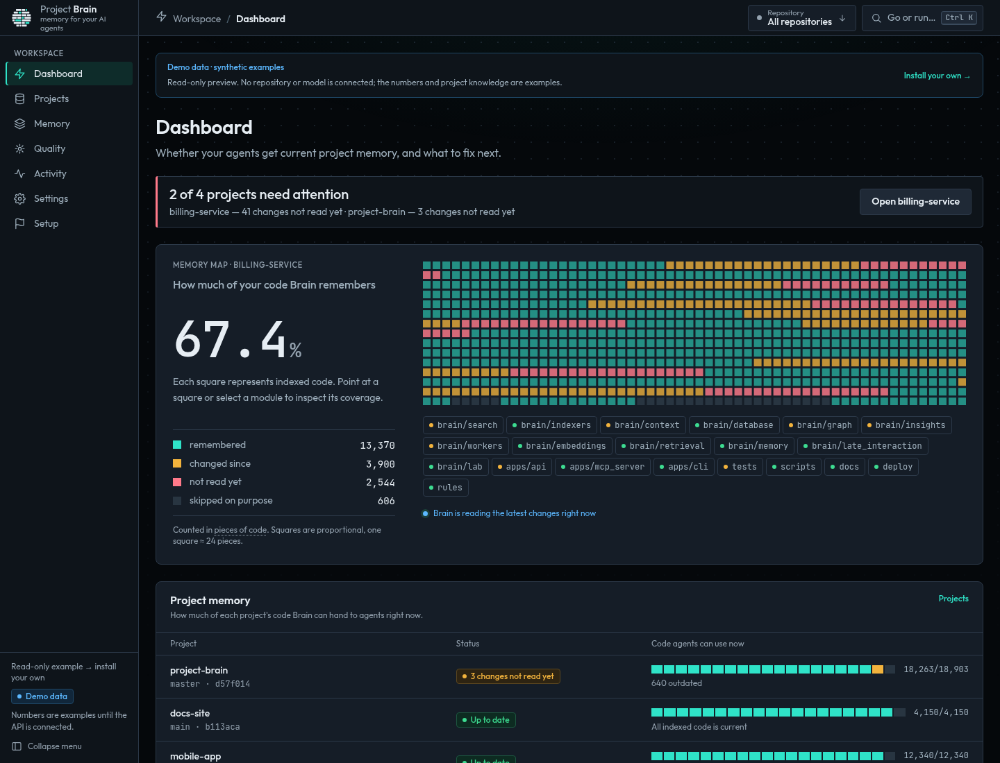
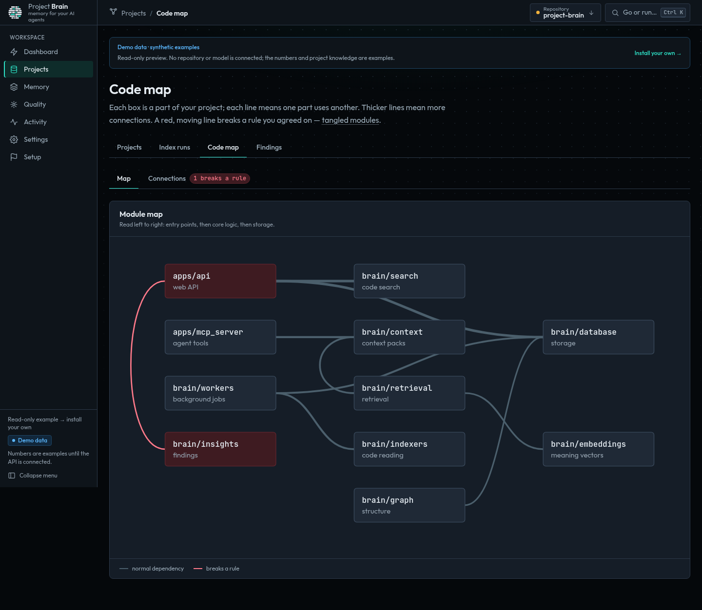
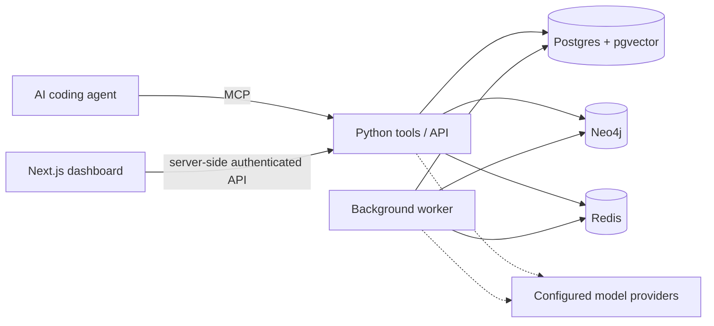

# Project Brain

**An inspectable memory and code intelligence layer for AI coding agents.**

Project Brain connects repository code, architectural decisions, rules and lessons
so an agent can request relevant project context across sessions and tools.
You run the storage and inspect what it remembers.

[](https://github.com/Perlitten/project-brain-public/actions/workflows/ci.yml)
[](LICENSE)

[Get started](#quickstart) · [Connect your agent](#connect-your-agent) ·
[Try the demo](https://project-brain-demo.vercel.app/) ·
[Documentation](docs/README.md) · [Evidence and limitations](#evidence-and-limitations)



*Real interface with synthetic example data. Screenshot values are illustrative,
not benchmark results or measurements from your repositories.*

Latest published release: **[v0.9.2](https://github.com/Perlitten/project-brain-public/releases/tag/v0.9.2)**.
Downloadable Python artifacts include checksums and an SBOM. For the complete
API, worker, dashboard and datastore setup, use the source workflow below.

## The problem

An agent can read code without knowing which decisions are still valid, why a
constraint exists, or what previous work learned. Those facts can be scattered
across conversations, documents and tools.

Project Brain gives connected agents a shared source of repository context.
It retrieves indexed code and recorded knowledge for a task, with evidence you
can inspect. The agent still reads current source and runs the relevant checks.

## What it does

- **Indexes code and maps dependencies.** Search files, symbols and chunks;
  inspect graph relationships and likely change impact.
- **Keeps repository-scoped knowledge.** Record architectural decisions and
  rules without mixing unrelated projects.
- **Links memory to evidence.** Capture observations and lessons, inspect their
  supporting evidence, and review higher-risk promotions.
- **Builds task context through MCP.** Request relevant source and constraints
  from Codex, Claude Code, Cursor or another MCP-compatible client.
- **Makes state visible.** Inspect projects, indexing, code relationships,
  context packs and memory from the dashboard.

This is early, single-user software for a trusted operator. It complements your
coding agent, Git and CI. It is not a multi-tenant service.

## Quickstart

The recommended path is a source checkout on **Linux**, with Python 3.12,
Docker Compose 2.24+ and Node.js 22 for the dashboard.
macOS, WSL2 and native Windows have not been verified to the same standard;
see [platform support](docs/GETTING_STARTED.md#requirements-and-platform-support).

Run from a terminal on the machine that will host Brain:

```bash
git clone --branch v0.9.2 https://github.com/Perlitten/project-brain-public.git project-brain
cd project-brain
./scripts/bootstrap.sh
.venv/bin/brain index --repo "$PWD"
./scripts/start.sh
```

Bootstrap creates `.venv` and `.env`, generates local API secrets, installs the
Python package, starts Postgres, Redis and Neo4j, and runs `brain doctor`.
The index command reads Brain's own clean checkout as a first example.
Start launches the API, worker and dashboard; keep that terminal open.

Open **http://127.0.0.1:3100/setup**. Check service health and the active
repository, then connect an agent below. Press Ctrl+C to stop the API, worker
and web app. Storage remains running until `docker compose stop`.

**The default providers are mocks.** This is a keyless installation smoke test;
mock embeddings do not establish meaningful semantic retrieval. Configure
[real models](docs/MODEL_PROVIDERS.md) before evaluating usefulness.

To use your own repository, pass its absolute path to bootstrap and indexing.
Git repositories must have a clean committed tree. Ignored generated files are
excluded; commit legitimate source changes before reindexing.

See [Getting started](docs/GETTING_STARTED.md) for repository selection, model
configuration, restart, troubleshooting and the first MCP task.
Prebuilt GHCR containers remain experimental and are outside this recommended
installation path.

## Connect your agent

### Local Lite profile (unreleased main)

In a checkout of `main`, install the Python package and open a terminal in your
own repository. Lite uses SQLite, local graph adjacency and a durable local
queue/cache; it starts no Docker containers or database daemons.

```bash
brain init --lite
brain index
brain mcp
# Optional local API and background maintenance worker:
brain serve --lite
```

`brain mcp` uses the saved `.brain` profile over stdio; point your MCP client at
the absolute `brain` executable with argument `mcp` and your repository as cwd.
Offline token-feature embeddings support identifier search; they do not provide
learned semantic retrieval. Chat answers require an explicitly configured model.
Lite supports bounded search/context/impact up to 50k chunks; advanced Cypher
administration uses the full stack. See [Lite setup](docs/GETTING_STARTED.md#lite-mode-unreleased-main).
Initial indexing on `main` uses deterministic summaries without chat completions.

The local stdio server reads Brain's `.env` and connects directly to its
storage services. Use the absolute path to the Python interpreter in the
checkout you just installed:

```bash
claude mcp add project-brain -- /absolute/path/project-brain/.venv/bin/python -m apps.mcp_server.server
```

Other MCP clients use the same command and arguments; see the
[client configuration and tool reference](docs/MCP.md).
For a separately hosted instance, authenticated Streamable HTTP and the
HTTP-backed stdio bridge are documented there and in [Deployment](docs/operations/DEPLOYMENT.md).

### A concrete first task

Ask your connected agent:

> Use Project Brain's `search_code` for `FileIndexer` in this repository.
> Read the returned source, then use `prepare_task_context` for the task:
> "Explain how ignored generated files are excluded during reindexing."
> Include the relevant implementation, tests and any applicable decisions.

Pass the same absolute `repo_path` used by indexing. The result should point to
source such as `brain/indexers/file_indexer.py` and its regression tests.
This exercises a real MCP connection and inspectable code retrieval; it does
not measure an improvement in coding outcomes.

After a change, an agent can request `review_diff`, record a scoped decision,
or capture a lesson with its validation evidence. Tool access does not mean
agents automatically call Brain in every session: configure your client workflow.

## See the product

[Open the public, read-only demo](https://project-brain-demo.vercel.app/).
It contains synthetic projects and numbers, with no connected Brain API in the
verified deployment. You can also inspect the screens locally after starting
the app; [Dashboard guide](docs/DASHBOARD.md) explains the views.



*Code-map screenshot: synthetic example data, not a measured impact analysis.*

See [Demo safety and verification](docs/DEMO.md) for the tested routes, deployment
provenance, isolation checks and limits of the verification.

## Architecture at a glance



Postgres stores the index, memory and durable jobs; Neo4j stores code
relationships; Redis supports queueing, cache and worker liveness. The CLI and
local MCP tools access the same core services. See
[Architecture and trust boundaries](docs/ARCHITECTURE.md).

**Self-hosted storage is not a local-only inference guarantee.** External
embedding providers receive code chunks; external LLMs receive selected code,
knowledge and prompts. Connected agents have their own data policies. For local
inference, configure both provider roles and review integrations and endpoints.

## Evidence and limitations

Installation, indexing and MCP workflows have end-to-end smoke coverage.
Python and web tests, migration checks, production-build checks, privacy gates
and CodeQL run in CI. [Evaluation guide](docs/EVAL.md) separates functional
verification from task-level experiments and retained historical evidence.

Improvements in coding correctness, task completion, time and total token cost
are **not established**. Mock-provider checks are functional smoke tests.
Benchmark evidence has limited scope and does not establish general superiority.

Memory records reported validation; Brain does not prove every lesson's tests
were executed. Eligible learned guidance can promote automatically, while
higher-risk cases and distilled procedures have approval gates. Explicit rules
and decisions are separate writes. Read the [memory policy](docs/MEMORY_LESSON_PROTOCOL.md).

## Documentation and contribution

Start with the [documentation index](docs/README.md). It separates current
installation and operating guides from historical research and release records.

- [Getting started](docs/GETTING_STARTED.md) and [MCP](docs/MCP.md)
- [FAQ](docs/FAQ.md), [Memory](docs/MEMORY.md) and [Roadmap](docs/ROADMAP.md)
- [Deployment](docs/operations/DEPLOYMENT.md) and [backup / restore](docs/runbooks/backup-restore.md)
- [Contributing](.github/CONTRIBUTING.md), [issues](https://github.com/Perlitten/project-brain-public/issues) and [Code of conduct](.github/CODE_OF_CONDUCT.md)
- [Security reporting](SECURITY.md) and [Changelog](CHANGELOG.md)

## License

[MIT](LICENSE). Third-party libraries, fonts, container images and models keep
their own licenses; see [Third-party notices](docs/legal/THIRD_PARTY_NOTICES.md).
This is an independent project, unaffiliated with the coding tools mentioned.
